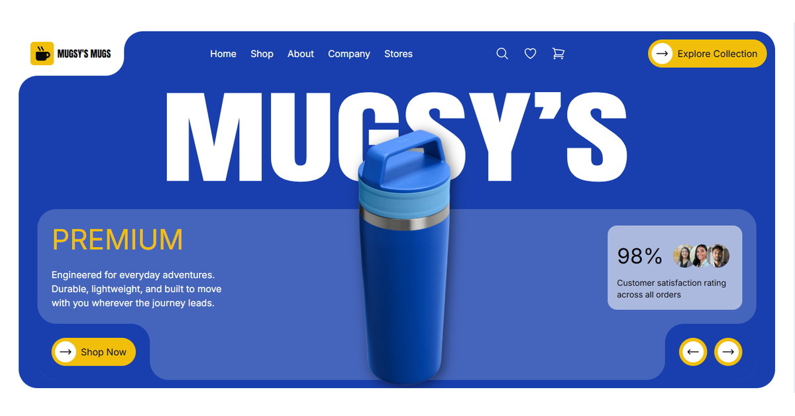
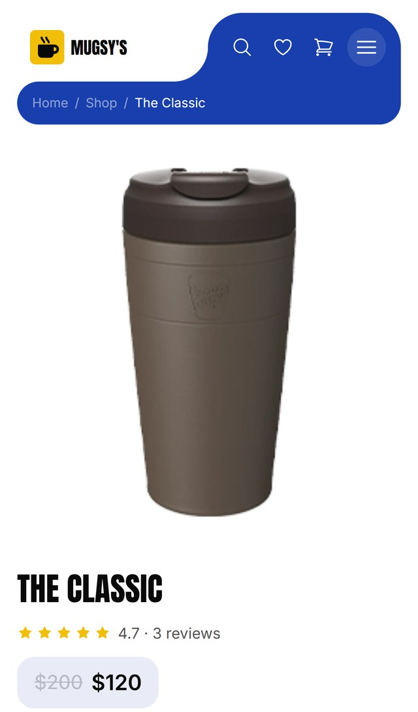
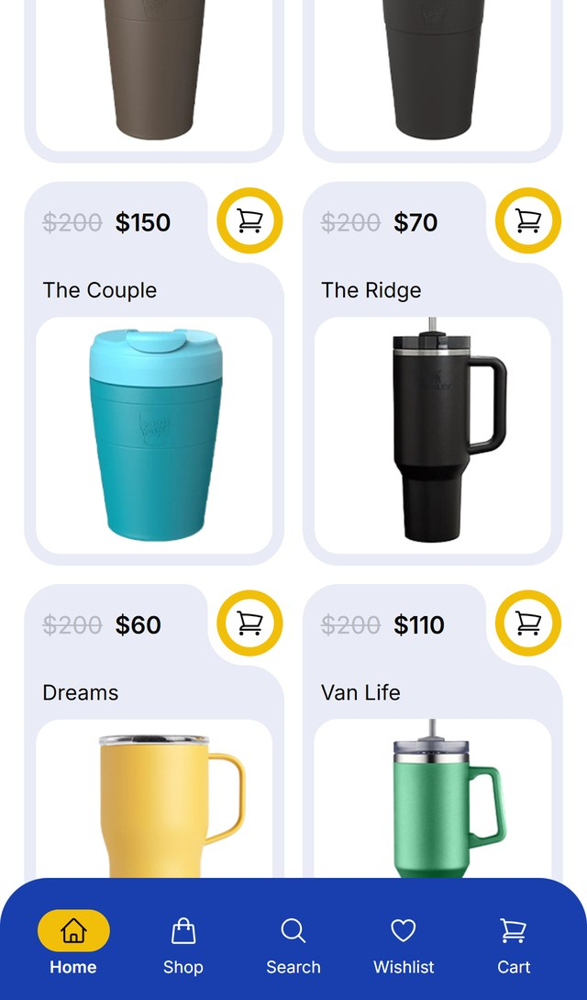
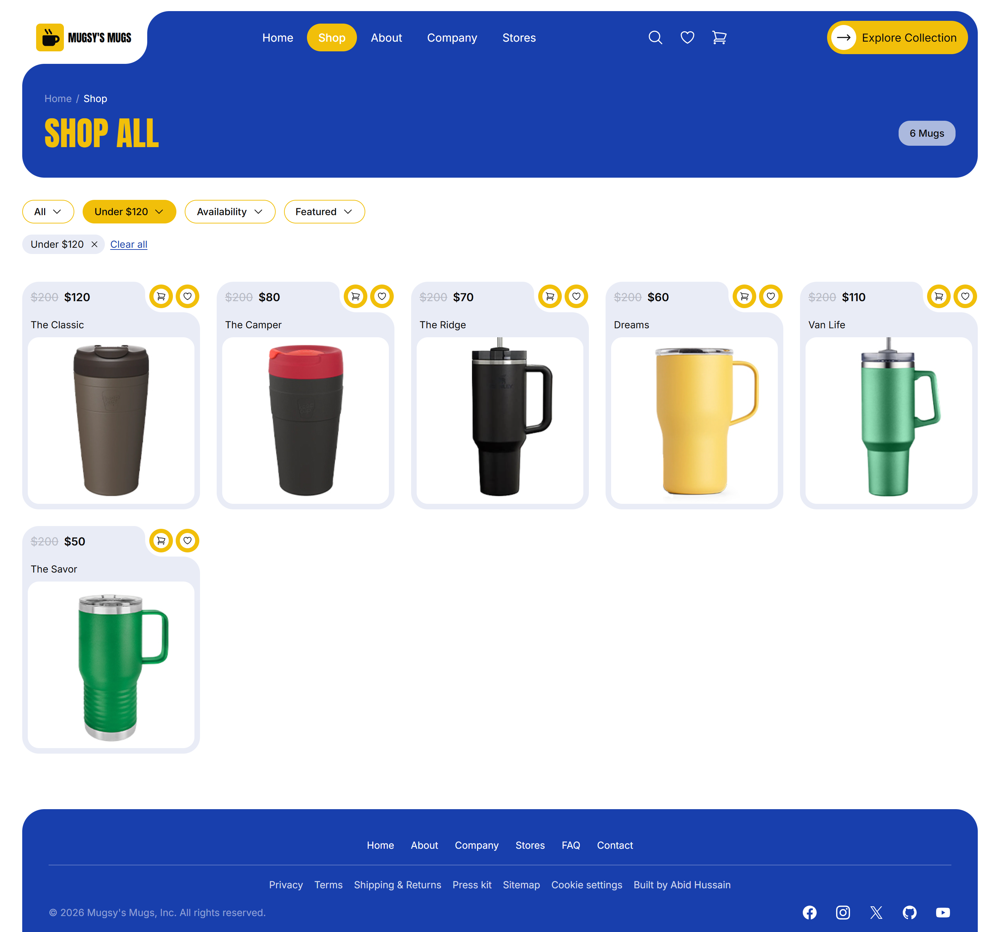
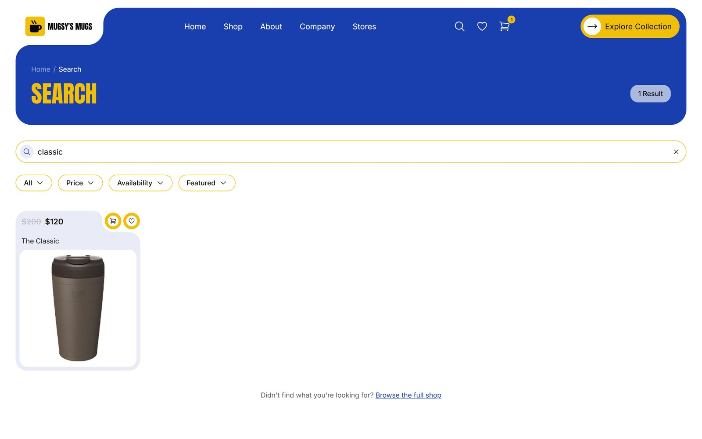
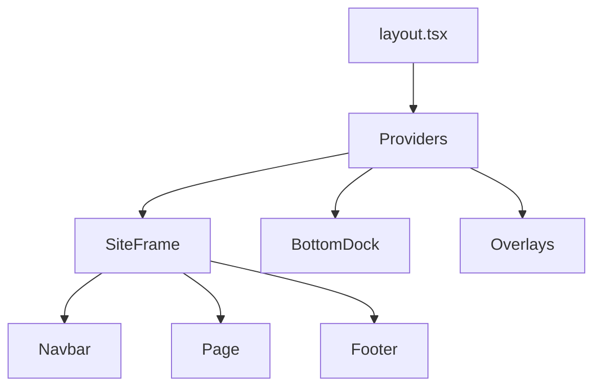

# Mugsy's Mugs

A storefront for a limited-edition travel mug collection (2,000 units per design), designed phone-first and built with Next.js 16, React 19, TypeScript and Tailwind CSS.

**[Live site](https://mugs-website.vercel.app/)**



> Mugsy's Mugs is a fictional brand. The products, reviews, stores and team are placeholder content.

Browse the collections, search, save favourites, fill a cart and check out. Everything runs in the browser from typed data files, so there is no database or API to set up.

## Screenshots

On a phone, navigation moves to a bottom tab bar and the add-to-cart button sticks to the bottom of the product page.

<table>
  <tr>
    <td></td>
    <td></td>
  </tr>
</table>

Shop page with filters:



Search with filters:



## What's inside

**Shopping**
- Landing page with an animated hero, trust strip, collection grid, craft story and specs comparison
- Shop with Travel, Camp and Gift collections, plus sorting and filters (price, availability, featured)
- Product pages with a gallery, colour and size selectors, specs, reviews and related mugs
- Search that updates as you type, with filters and a no-results state
- Wishlist, and reviews you can write, both saved in the browser
- Cart drawer, full cart page, promo code, and a checkout with an order summary

**Content and trust**
- About, Company, Stores, FAQ, Contact, Gift cards, Privacy, Terms, Shipping and Returns
- Cookie notice with preferences, press kit with logo downloads, HTML sitemap
- A developer page with its own search-engine markup and social preview image

**Built for phones**
- Bottom tab bar that appears once you scroll past the hero, a full-screen menu, an accordion footer
- Sticky add-to-cart and checkout bars that step aside when the footer comes into view
- A short splash screen on the first visit of a session

**Motion and accessibility**
- Framer Motion for entrances, scroll reveals, a sliding active-link pill and tap feedback
- `prefers-reduced-motion` is respected everywhere
- Keyboard focus styles, labelled form fields, and 16px inputs so phones don't zoom on focus

## What it doesn't do

There is no backend. Payments, gift cards and the contact form are simulated in the browser, so nothing is charged, sent or stored on a server. The cart, wishlist, reviews, cookie choice and dismissed announcement bar are saved in `localStorage`.

## Run it locally

You need Node.js 20.9 or newer. From the repository root:

```bash
npm install
npm run dev
```

Then open <http://localhost:3000>.

| Command | What it does |
| --- | --- |
| `npm run dev` | Development server with hot reload (webpack) |
| `npm run build` | Production build, type-checked |
| `npm start` | Serve the production build |
| `npm run lint` | ESLint across the project |

## Stack

| Area | Choice |
| --- | --- |
| Framework | Next.js 16 (App Router), React 19 |
| Language | TypeScript, strict mode |
| Styling | Tailwind CSS v4, plus one small `styles.css` for what utilities can't do |
| Motion | Framer Motion 13, with CSS keyframes for the splash screen and toasts |
| Fonts | Anton for headings and Inter for body text, loaded with `next/font` |
| State | React Context for cart, wishlist, reviews, cookie consent and the cart drawer |
| Data | Typed modules in `src/data`, with `localStorage` for browser state |
| SEO | Metadata API, `sitemap.xml`, `robots.txt`, JSON-LD and a generated Open Graph image |

## How it fits together



The providers hold the cart, wishlist, reviews, cookie consent and cart drawer state. `BottomDock` is the mobile tab bar and cookie notice; the overlays are the cart drawer, toasts and splash screen. The navbar and footer live in the root layout and stay mounted between pages, so only a page's own content changes when you navigate. Each page wraps its content in `PageShell`, and its `<main>` takes `flex-1` so the footer sits at the bottom of short pages.

<details>
<summary><strong>Project structure</strong></summary>

```
.
├── public/
│   ├── og-image.jpg, og-image.png
│   └── press/          Logo files and the press kit download
└── src/
    ├── app/            One folder per route, root layout, error and 404 screens,
    │                   sitemap and robots, global styles (styles.css)
    ├── components/     Navbar, footer, hero, product and cart UI, forms, pickers,
    │                   buttons, tab bar, splash screen, motion helpers
    ├── context/        Cart, wishlist, reviews, cookie consent and cart drawer state
    ├── data/           Products, reviews, FAQ, legal text, stores, story,
    │                   social links, developer profile
    └── lib/            Navigation, pricing rules, policies, motion tokens, dates,
                        site URL and small hooks
```

</details>

## Changing things

| To change | Edit |
| --- | --- |
| Products, prices, images, colours, sizes | `src/data/products.ts` |
| Shipping threshold, tax, promo code | `src/lib/pricing.ts` |
| Support email, phone, return window, dispatch time | `src/lib/policies.ts` |
| Navigation and footer links | `src/lib/nav.ts` |
| FAQ questions and answers | `src/data/faq.ts` |
| Privacy, Terms and Shipping text | `src/data/legal.ts` |
| Social links | `src/data/social.ts` |
| Developer page and credit | `src/data/developer.ts` |
| Site address used in metadata and the sitemap | `src/lib/site.ts` |
| Animation timing and easing | `src/lib/motion.ts` |
| Allowed image hosts | `next.config.ts` |

### Design tokens

| Token | Value | Used for |
| --- | --- | --- |
| Primary blue | `#183fad` | Header, footer, panels |
| Mid blue | `#4565bc` | Hero panel, accents |
| Yellow | `#F1BF0A` | Buttons, active states, highlights |
| Off-white | `#e9ecf6` | Tracks, soft backgrounds |
| Ink | `#090909` | Text |

Shapes follow one language: large rounded panels, a notched logo tab on the header, and yellow pill buttons whose white circle expands on hover (and fills on press on touch screens).

## Deploying

It deploys as a standard Next.js app. On [Vercel](https://vercel.com), import the repository and deploy from its root. Set `NEXT_PUBLIC_SITE_URL` to the deployment's public URL; it defaults to `https://mugs-website.vercel.app`.

## Working with AI assistants

`AGENTS.md` and `CLAUDE.md` in the project root describe the conventions in this codebase for coding assistants.

## Author

Designed and built by [Abid Hussain](https://github.com/AbidHussainOFFICIAL), a full-stack developer based in Karachi, Pakistan. More about the author is on the site's `/developer` page, or find me on [LinkedIn](https://www.linkedin.com/in/abidhussainsoftware/).

## License

Copyright © 2026 Abid Hussain. All rights reserved.