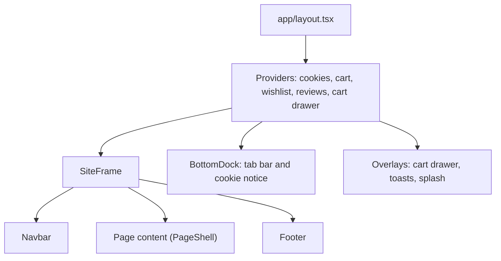

# Mugsy's Mugs

A storefront for a limited-edition run of 2,000 travel mugs: browse, search, save favourites, fill a cart and check out, designed phone-first and animated throughout.

Built with Next.js 16 (App Router), React 19, TypeScript and Tailwind CSS v4. Everything runs in the browser from typed data files, so there is no database or API to set up.

## Quick start

You need Node.js 20.9 or newer. From the project's `frontend` folder:

```bash
npm install
npm run dev
```

Open <http://localhost:3000>.

| Command         | What it does                                  |
| --------------- | --------------------------------------------- |
| `npm run dev`   | Development server with hot reload (webpack)  |
| `npm run build` | Production build, type-checked                |
| `npm start`     | Serve the production build                    |
| `npm run lint`  | ESLint across the project                     |

## What's inside

**Shopping**
- Landing page with an animated hero, trust strip, collection grid, craft story and specs comparison
- Shop with Travel, Camp and Gift collections, sorting and filters (price, availability, featured)
- Product pages with a gallery, colour and size selectors, specs, reviews and related mugs
- Search with results as you type, filters and a friendly no-results state
- Wishlist and reviews that persist in the browser
- Cart drawer, full cart page, promo code and a demo checkout with order summary

**Content and trust**
- About, Company, Stores, FAQ, Contact form, Gift cards (purchase and balance check, demo only)
- Privacy, Terms and Shipping & Returns, cookie notice with preferences, press kit with logo downloads, HTML sitemap
- A developer page with its own search-engine markup and social preview image

**Built for phones**
- Bottom tab bar that appears once you scroll past the hero, a full-screen menu, and an accordion footer
- A short splash screen on the first visit of a session
- Sticky add-to-cart and checkout bars that step aside when the footer comes into view

**Motion and accessibility**
- A shared motion system (Framer Motion) for entrances, scroll reveals, a sliding active-link pill, and tap feedback
- `prefers-reduced-motion` is respected everywhere
- Keyboard focus styles, labelled controls, and 16px form fields so phones don't zoom on focus

## Stack

| Area      | Choice                                                         |
| --------- | -------------------------------------------------------------- |
| Framework | Next.js 16 App Router, React 19                                |
| Language  | TypeScript (strict)                                            |
| Styling   | Tailwind CSS v4, one small `styles.css` for what utilities can't do |
| Motion    | Framer Motion 13, plus CSS keyframes for the splash and toasts |
| Fonts     | Anton (headings) and Inter (body) via `next/font`              |
| State     | React Context (cart, wishlist, reviews, cookie consent, cart drawer) |
| Data      | Typed modules in `src/data`; browser storage for wishlist and reviews |
| SEO       | Metadata API, `sitemap.xml`, `robots.txt`, JSON-LD, generated Open Graph image |

## How it fits together



The Navbar and Footer live in the root layout and stay mounted between pages, so only a page's own content changes on navigation. Each page wraps its content in `PageShell`, and its `<main>` takes `flex-1` so the footer sits at the bottom of short pages.

<details>
<summary><strong>Project structure</strong></summary>

```
frontend/
├── public/
│   └── press/              Logo files and the press kit download
└── src/
    ├── app/                Routes (one folder per page), layout, error and 404 screens,
    │                       sitemap, global styles (styles.css)
    ├── components/         Navbar, Footer, Hero, product and cart UI, forms, pickers,
    │                       buttons, dock and tab bar, splash, motion helpers
    ├── context/            Cart, wishlist, reviews, cookie consent and cart drawer state
    ├── data/               Products, reviews, FAQ, legal text, stockists, story,
    │                       social links, developer profile
    └── lib/                Navigation, pricing rules, store facts, motion tokens,
                            dates, site URL, and small hooks
```

</details>

## Customising

| To change                                    | Edit                                  |
| -------------------------------------------- | ------------------------------------- |
| Products, prices, images, colours, sizes     | `src/data/products.ts`                |
| Shipping threshold, tax, promo code          | `src/lib/pricing.ts`                  |
| Support email, phone, return window, dispatch time | `src/lib/policies.ts`           |
| Navigation and footer links                  | `src/lib/nav.ts`                      |
| FAQ questions and answers                    | `src/data/faq.ts`                     |
| Privacy, Terms and Shipping & Returns text   | `src/data/legal.ts`                   |
| Social links                                 | `src/data/social.ts`                  |
| Developer page and credit                    | `src/data/developer.ts`               |
| Site address used in metadata and the sitemap | `src/lib/site.ts`                    |
| Animation timing and easing                  | `src/lib/motion.ts`                   |
| Allowed image hosts                          | `next.config.ts`                      |

### Design tokens

| Token       | Value     | Used for                                |
| ----------- | --------- | --------------------------------------- |
| Primary blue | `#183fad` | Header, footer, panels                  |
| Mid blue    | `#4565bc` | Hero panel, accents                     |
| Yellow      | `#F1BF0A` | Buttons, active states, highlights      |
| Off-white   | `#e9ecf6` | Tracks, soft backgrounds                |
| Ink         | `#090909` | Text                                    |

Shapes follow one language: large rounded panels, a notched logo tab on the header, and yellow pill buttons whose white circle expands on hover (and fills on press on touch screens).

## Deploying

The project deploys as a standard Next.js app. On [Vercel](https://vercel.com), import the repository, set the root directory to `frontend`, and deploy. Before you go live, set your real address in `src/lib/site.ts` so canonical links, the sitemap and social previews point to your domain.

## Working with AI assistants

`AGENTS.md` and `CLAUDE.md` in the project root describe the conventions in this codebase for coding assistants.

## Author

Designed and built by [Abid Hussain](https://github.com/AbidHussainOFFICIAL), a full-stack developer based in Karachi, Pakistan. More about the author is on the site's `/developer` page, or reach out at 010abidhussain@gmail.com.

## License

Copyright © 2026 Mugsy's Mugs, Inc. All rights reserved.